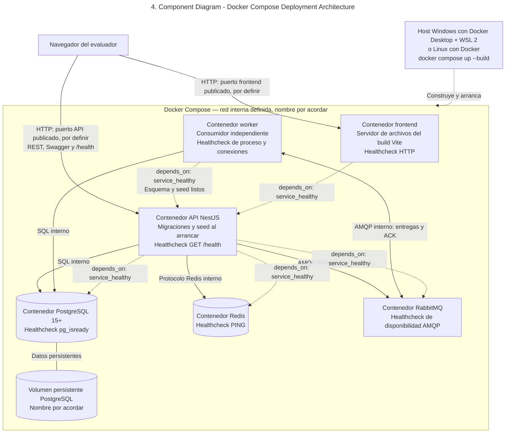
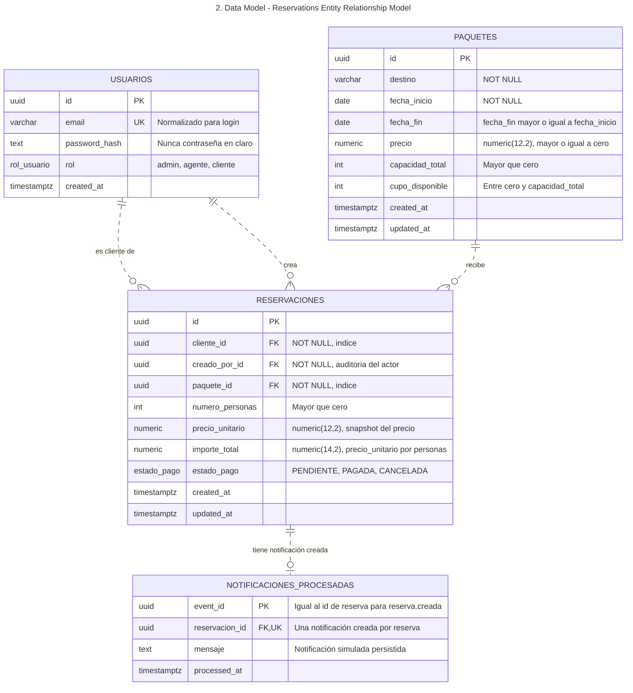
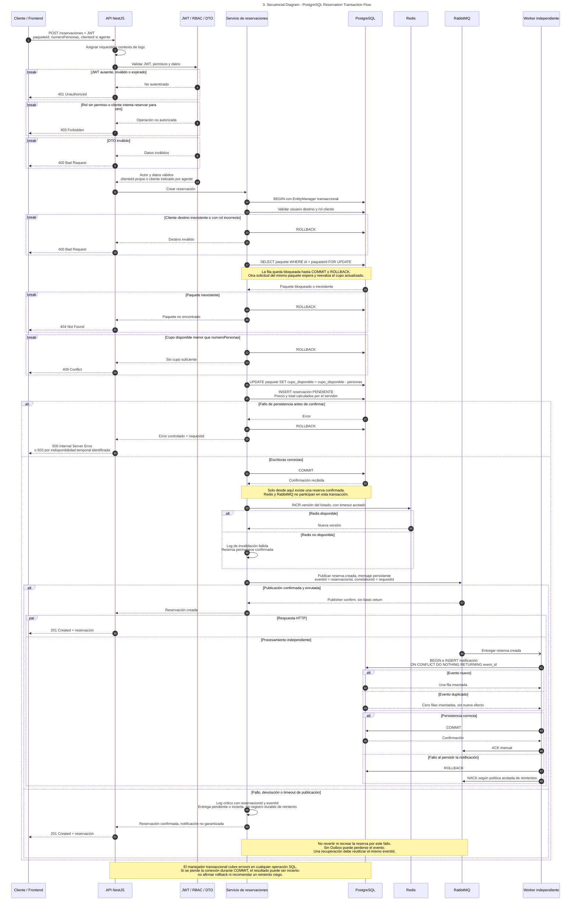
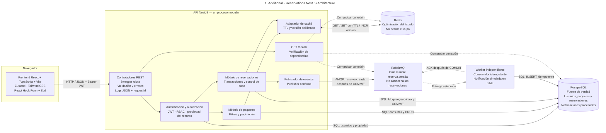

# Diseño de la solución

Objetivo: validar que el candidato puede modelar un dominio sencillo, tomar decisiones técnicas justificadas y comunicarlas con claridad.

# Requisitos técnicos:

## Diagrama de componentes

## Modelo de datos

## Diagrama de secuencia del flujo "crear reservación"

### Diagrama adicional para facilitar la vista de la secuencia de una reservación

## Decisiones técnicas

**Proyecto:** Sistema de gestión de paquetes turísticos y reservaciones --- Viajes Lili

**Propósito:** Documentar las principales decisiones de arquitectura y
explicar cómo responden a los requisitos de la prueba técnica.

## 1. Stack tecnológico, persistencia y acceso a datos

- **Decisión:** Utilizar React con TypeScript para el frontend, NestJS con
  TypeScript para la API y PostgreSQL como fuente de verdad, accedido mediante
  TypeORM y migraciones.
- **Justificación:** TypeScript aporta tipado estático en ambas capas y NestJS
  permite separar responsabilidades en módulos. PostgreSQL ofrece la
  consistencia transaccional que requieren las reservaciones y la disponibilidad;
  TypeORM permite definir entidades, relaciones y migraciones.
- **Aplicación:** Organizar el backend en controladores, servicios, DTOs y
  módulos. Gestionar cambios de cupo y reservaciones dentro de transacciones,
  usando siempre el `EntityManager` transaccional. Versionar el esquema con
  migraciones y no habilitar `synchronize: true` en entornos de entrega.

## 2. Control de concurrencia para evitar sobreventa

- **Decisión:** Bloquear la fila del paquete durante la validación y actualización
  de disponibilidad, mediante una transacción y un bloqueo pesimista de escritura
  (`SELECT ... FOR UPDATE`).
- **Justificación:** El bloqueo serializa las solicitudes concurrentes sobre el
  mismo paquete y permite volver a validar el cupo antes de descontarlo.
- **Aplicación:** Dentro de una misma transacción, bloquear el paquete, comprobar
  disponibilidad, crear la reservación y descontar los lugares. Si no hay cupo,
  no modificar los datos y responder con `409 Conflict`. Verificar con pruebas
  que el cupo nunca sea negativo ni se sobrevendan lugares.

## 3. Redis para caché, no para controlar inventario

- **Decisión:** Cachear temporalmente con TTL los resultados frecuentes del
  listado de paquetes.
- **Justificación:** Redis reduce lecturas repetidas a PostgreSQL, pero sus datos
  pueden estar desactualizados y no deben decidir si una reservación puede
  confirmarse.
- **Aplicación:** Consultar PostgreSQL ante un cache miss e invalidar el listado
  cuando se cree o edite un paquete, o cambie su disponibilidad por una
  reservación o cancelación. La validación final del cupo siempre se hace contra
  PostgreSQL dentro de la transacción.

## 4. RabbitMQ y procesamiento asíncrono mediante un worker

- **Decisión:** Publicar el evento `reserva.creada` en RabbitMQ para que lo
  procese un worker independiente de la API.
- **Justificación:** Desacoplar la persistencia de la reservación del
  procesamiento de notificaciones evita ejecutar ambas tareas dentro de la
  misma petición HTTP.
- **Aplicación:** Confirmar la transacción de PostgreSQL antes de publicar.
  El worker registra una notificación simulada y confirma el mensaje con ACK
  después de persistirla. Existe una ventana en la que la reserva puede quedar
  confirmada aunque falle la publicación; un patrón Transactional Outbox sería
  una alternativa para mejorar esa garantía.

## 5. Idempotencia del worker

- **Decisión:** Hacer idempotente el procesamiento de `reserva.creada` mediante
  un identificador único del evento respaldado por una restricción en PostgreSQL.
- **Justificación:** RabbitMQ puede entregar de nuevo un mensaje si el worker
  falla antes de confirmar el ACK; esos reintentos no deben duplicar
  notificaciones.
- **Aplicación:** Registrar el evento de forma atómica, por ejemplo con
  `INSERT ... ON CONFLICT DO NOTHING`, y confirmar el mensaje solo después de
  guardar el resultado. La clave de idempotencia debe identificar de forma
  inequívoca el efecto que se procesa.

## 6. Autenticación, autorización y validación de solicitudes

- **Decisión:** Usar JWT para autenticar y aplicar autorización por rol y
  propiedad del recurso; validar entradas con DTOs y `class-validator`.
- **Justificación:** Los roles admin, agente y cliente tienen permisos
  distintos. La validación y los errores HTTP consistentes ayudan a proteger
  los datos y a que los clientes de la API reaccionen de forma predecible.
- **Aplicación:** Comprobar permisos y propiedad de las reservaciones; responder
  `401` si la autenticación falta o no es válida, `403` si el usuario no tiene
  permiso, `400` ante datos inválidos, `404` ante recursos inexistentes y `409`
  ante conflictos como falta de cupo. Almacenar contraseñas con bcrypt,
  configurar CORS explícitamente, limitar intentos de inicio de sesión y no
  exponer trazas ni datos sensibles en errores de producción.

## 7. Observabilidad y entorno reproducible

- **Decisión:** Exponer `GET /health`, documentar la API con OpenAPI/Swagger y
  ejecutar frontend, API, worker, PostgreSQL, Redis y RabbitMQ mediante Docker
  Compose.
- **Justificación:** Los health checks y logs con contexto facilitan el
  diagnóstico; Swagger facilita probar la API y Compose reduce diferencias entre
  entornos.
- **Aplicación:** Comprobar PostgreSQL, Redis y RabbitMQ en el health check;
  incluir identificadores de solicitud en logs sin registrar secretos. Definir
  health checks y dependencias de inicio, persistir PostgreSQL en un volumen,
  gestionar configuración con variables de entorno y mantener un `.env.example`
  sin secretos reales. Dentro de Compose, conectar los servicios mediante sus
  nombres de servicio.

## 8. Estrategia de pruebas

- **Decisión:** Combinar pruebas unitarias de servicios de dominio con pruebas
  del frontend y pruebas de integración o extremo a extremo para flujos críticos.
- **Justificación:** Las reglas de reservación y concurrencia requieren
  verificarse más allá de que la aplicación compile.
- **Aplicación:** Cubrir creación con cupo disponible, rechazo por cupo
  insuficiente, cancelación y restitución del cupo, autorización por propiedad y
  procesamiento idempotente. Probar también filtros y formularios del frontend,
  respetando los mínimos definidos en la prueba técnica.

## Resumen de decisiones

- **Stack, persistencia y acceso a datos:** React, NestJS, PostgreSQL y TypeORM
  con migraciones.
- **Concurrencia:** transacciones y bloqueo de fila para evitar sobreventa.
- **Caché:** Redis acelera listados, pero no decide la disponibilidad real.
- **Mensajería:** RabbitMQ y worker desacoplan las notificaciones.
- **Idempotencia:** los reintentos no duplican efectos.
- **Seguridad y validación:** JWT, roles, propiedad del recurso y DTOs.
- **Operación:** health checks, logs, Swagger y Compose favorecen diagnóstico y
  reproducibilidad.
- **Pruebas:** verifican reglas críticas del backend y frontend.
