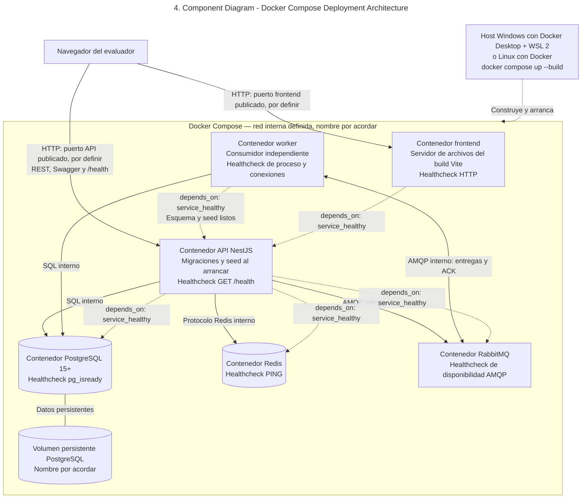
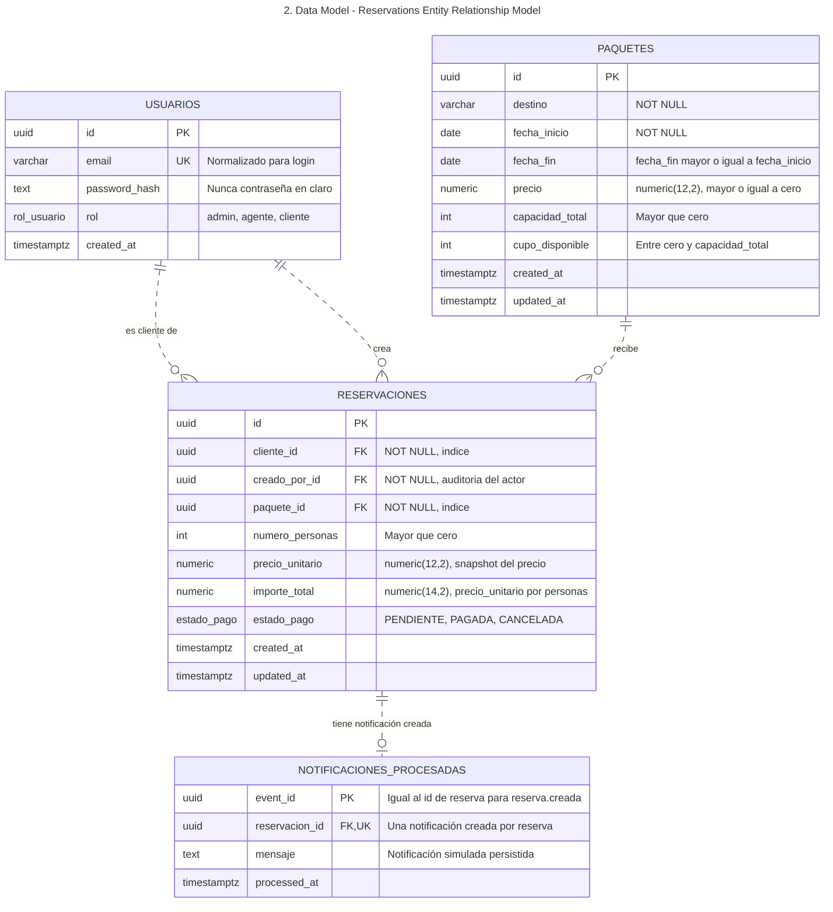
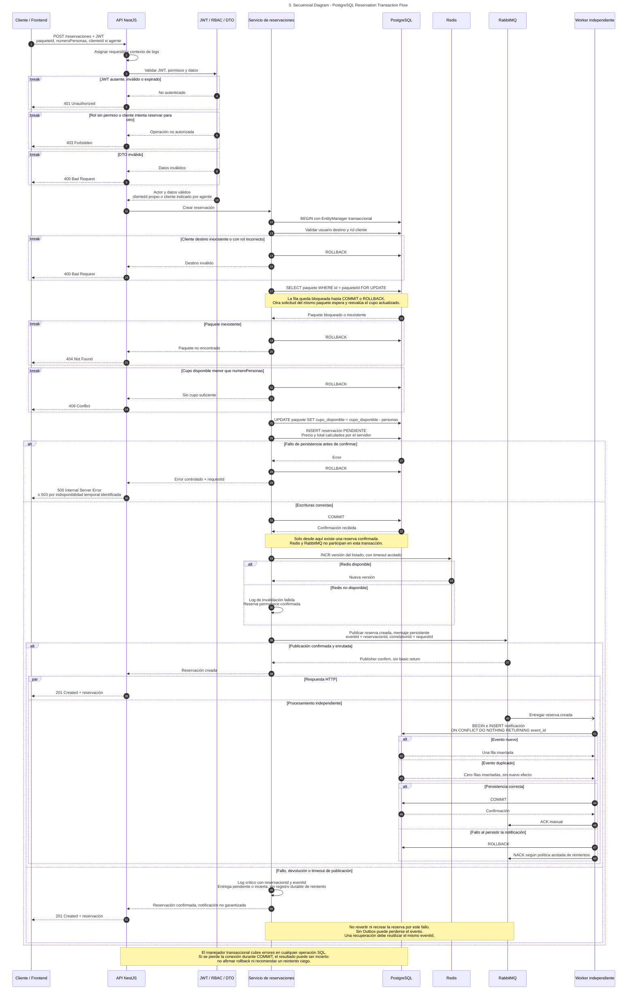
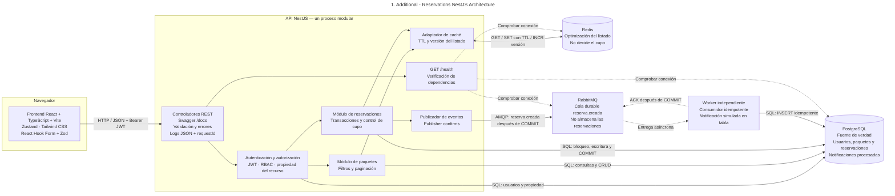

# Diseño de la solución

Objetivo: validar que el candidato puede modelar un dominio sencillo, tomar decisiones técnicas justificadas y comunicarlas con claridad.

# Requisitos técnicos:

## Diagrama de componentes

## Modelo de datos

## Diagrama de secuencia del flujo "crear reservación"

### Diagrama adicional para facilitar la vista de la secuencia de una reservación

## Decisiones técnicas

**Proyecto:** Sistema de gestión de paquetes turísticos y reservaciones --- Viajes Lili

**Propósito:** Documentar las principales decisiones de arquitectura y
explicar cómo responden a los requisitos de la prueba técnica.

## 1. Stack tecnológico y organización del backend

-   **Decisión:** Utilizar React con TypeScript para el frontend y
    NestJS con TypeScript para la API.
-   **Justificación:** TypeScript aporta tipado estático en ambas capas,
    mientras que NestJS permite organizar el backend en módulos y
    separar responsabilidades como autenticación, usuarios, paquetes y
    reservaciones.
-   **Aplicación:** Mantener controladores, servicios, DTOs y módulos
    con responsabilidades claras, facilitando pruebas y mantenimiento.

## 2. PostgreSQL como fuente de verdad

-   **Decisión:** Utilizar PostgreSQL como almacenamiento persistente
    principal para usuarios, paquetes y reservaciones.
-   **Justificación:** Las reservaciones y la disponibilidad de lugares
    requieren consistencia transaccional. La base de datos debe ser la
    autoridad definitiva sobre el cupo disponible y el estado de cada
    reservación.
-   **Aplicación:** Gestionar los cambios de cupo y la creación o
    cancelación de reservaciones dentro de transacciones. Utilizar
    migraciones para versionar los cambios del esquema y evitar
    `synchronize: true` en entornos de entrega.

## 3. TypeORM para acceso a datos

-   **Decisión:** Utilizar TypeORM como ORM para conectar NestJS con
    PostgreSQL.
-   **Justificación:** Permite definir entidades, relaciones y
    migraciones, además de ejecutar operaciones dentro de transacciones.
-   **Aplicación:** En una transacción, todas las consultas y escrituras
    relacionadas deben utilizar el `EntityManager` transaccional
    proporcionado por TypeORM, evitando mezclar operaciones
    transaccionales con el administrador global.

## 4. Control de concurrencia para evitar sobreventa

-   **Decisión:** Bloquear la fila del paquete durante la validación y
    actualización de disponibilidad mediante una transacción y un
    bloqueo pesimista de escritura, por ejemplo `SELECT ... FOR UPDATE`.
-   **Justificación:** Dos solicitudes simultáneas podrían leer el mismo
    cupo disponible e intentar reservar los mismos lugares. El bloqueo
    serializa las operaciones que afectan esa fila y permite volver a
    validar el cupo antes de descontarlo.
-   **Aplicación:** Dentro de la transacción, obtener el paquete con el
    bloqueo, comprobar que el cupo sea suficiente, crear la reservación
    y actualizar la disponibilidad. Si no hay cupo, rechazar la
    operación sin modificar los datos y responder con un conflicto HTTP
    `409`.
-   **Consideración:** El bloqueo debe ejecutarse dentro de una
    transacción real y sobre la misma conexión transaccional. La
    estrategia debe probarse con solicitudes concurrentes para confirmar
    que el cupo nunca quede negativo ni se sobrevendan lugares.

## 5. Redis para caché, no para controlar inventario

-   **Decisión:** Utilizar Redis para almacenar temporalmente resultados
    de consultas frecuentes del listado de paquetes, con un TTL
    definido.
-   **Justificación:** El caché puede reducir lecturas repetidas a
    PostgreSQL y mejorar el tiempo de respuesta. Sin embargo, su
    contenido puede estar desactualizado y no debe utilizarse como
    fuente definitiva para confirmar una reservación.
-   **Aplicación:** Ante una consulta, revisar primero el caché y
    consultar PostgreSQL si no existe una entrada válida. Invalidar las
    entradas relevantes cuando se cree o edite un paquete o cambie la
    disponibilidad por una reservación o cancelación.
-   **Consideración:** La operación de creación de reservaciones siempre
    valida el cupo contra PostgreSQL dentro de la transacción, aunque el
    listado almacenado en Redis muestre disponibilidad.

## 6. RabbitMQ y procesamiento asíncrono mediante un worker

-   **Decisión:** Utilizar RabbitMQ para distribuir el evento
    `reserva.creada` a un worker independiente de la API.
-   **Justificación:** Separar el registro de la reservación del
    procesamiento de notificaciones evita acoplar ambas tareas en la
    misma petición HTTP y permite procesar el evento de manera
    independiente.
-   **Aplicación:** La API confirma la transacción de PostgreSQL y
    después publica el evento. El worker consume el mensaje, registra
    una notificación simulada y confirma el procesamiento mediante ACK
    cuando la operación concluye correctamente.
-   **Consideración de fiabilidad:** Publicar después del `COMMIT` evita
    notificar una transacción que haya sido revertida, pero existe una
    ventana en la que la base de datos puede confirmar la reservación y
    la publicación fallar. Para una solución más robusta podría
    incorporarse el patrón Transactional Outbox.

## 7. Idempotencia del worker

-   **Decisión:** Hacer que el procesamiento de `reserva.creada` sea
    idempotente mediante un identificador único del evento o una clave
    de negocio apropiada, respaldada por una restricción única en
    PostgreSQL.
-   **Justificación:** RabbitMQ puede volver a entregar un mensaje si el
    worker falla o pierde la conexión antes de confirmar el ACK. El
    procesamiento debe tolerar entregas repetidas sin crear
    notificaciones duplicadas.
-   **Aplicación:** Registrar el evento procesado o la notificación
    usando una operación atómica, por ejemplo
    `INSERT ... ON CONFLICT DO NOTHING`, y confirmar el mensaje solo
    después de que el resultado se haya guardado correctamente.
-   **Consideración:** La clave de idempotencia debe representar
    inequívocamente el evento que se procesa. Si se permiten varios
    tipos de notificación por reservación, una restricción única solo
    por `reservation_id` podría ser demasiado restrictiva; debe
    definirse la clave según el modelo real.

## 8. Autenticación y autorización por roles

-   **Decisión:** Utilizar JWT para autenticar solicitudes y controles
    de autorización basados en roles y propiedad del recurso.
-   **Justificación:** La prueba distingue entre administradores,
    agentes y clientes. Autenticarse no significa tener permiso para
    realizar cualquier acción: la API debe comprobar tanto el rol como
    el acceso al recurso solicitado.
-   **Aplicación:** Proteger las rutas correspondientes y verificar que
    un cliente solo pueda consultar o cancelar sus propias
    reservaciones, mientras que los roles autorizados puedan realizar
    las operaciones administrativas definidas. Responder `401` cuando
    falte una autenticación válida y `403` cuando un usuario autenticado
    no tenga permiso.
-   **Seguridad complementaria:** Validar entradas mediante DTOs y
    `class-validator`, almacenar contraseñas con un algoritmo de hash
    adecuado como bcrypt, configurar CORS explícitamente y limitar
    intentos de inicio de sesión.

## 9. Validación de datos y respuestas HTTP consistentes

-   **Decisión:** Validar los datos entrantes en la API y centralizar el
    manejo de errores.
-   **Justificación:** La validación temprana reduce datos inválidos y
    facilita que el frontend interprete los errores de forma predecible.
-   **Aplicación:** Usar DTOs y validaciones para los cuerpos y
    parámetros; responder con códigos HTTP adecuados, incluyendo `400`
    para datos inválidos, `401` para solicitudes no autenticadas, `403`
    para acceso prohibido, `404` para recursos inexistentes y `409` para
    conflictos como falta de cupo.
-   **Seguridad:** No exponer trazas internas ni detalles sensibles en
    respuestas de error de producción.

## 10. Health checks, logging y documentación de API

-   **Decisión:** Exponer `GET /health`, generar logs estructurados con
    un identificador de solicitud y publicar documentación
    OpenAPI/Swagger.
-   **Justificación:** Estas herramientas facilitan verificar el estado
    de los servicios, rastrear errores entre componentes y probar la API
    durante la evaluación.
-   **Aplicación:** El health check debe comprobar las dependencias
    relevantes ---PostgreSQL, Redis y RabbitMQ--- e indicar un estado
    degradado o no saludable cuando corresponda. Los logs deben incluir
    contexto útil sin registrar contraseñas, tokens ni datos sensibles.
    Swagger debe describir endpoints, DTOs, autenticación y respuestas
    de error.

## 11. Contenedores y entorno reproducible

-   **Decisión:** Utilizar Docker Compose para ejecutar frontend, API,
    worker, PostgreSQL, Redis y RabbitMQ.
-   **Justificación:** Un entorno declarado como código reduce
    diferencias entre máquinas y permite levantar la solución con un
    flujo reproducible.
-   **Aplicación:** Definir health checks y dependencias de inicio,
    persistir los datos de PostgreSQL mediante un volumen, gestionar la
    configuración mediante variables de entorno y proporcionar un
    archivo `.env.example` sin secretos reales. La configuración de
    entrega debe incluir migraciones y datos semilla cuando sean
    necesarios.
-   **Consideración:** Dentro de la red de Compose, los servicios deben
    conectarse mediante los nombres de servicio definidos en Compose, no
    mediante `localhost`.

## 12. Estrategia de pruebas

-   **Decisión:** Combinar pruebas unitarias de servicios de dominio con
    pruebas del frontend y pruebas de integración o extremo a extremo
    para los flujos críticos.
-   **Justificación:** La lógica de reservaciones contiene reglas de
    negocio y condiciones de concurrencia que deben verificarse más allá
    de que la aplicación compile.
-   **Aplicación:** Cubrir al menos la creación de reservaciones con
    cupo disponible, el rechazo por cupo insuficiente, la cancelación y
    restitución del cupo, la autorización por propiedad de la
    reservación y el procesamiento idempotente de mensajes. Probar
    también el comportamiento de filtros y formularios en el frontend,
    respetando los mínimos definidos en la prueba técnica.

## Resumen de decisiones

-   **NestJS y React con TypeScript:** separar frontend y API con tipado
    compartido como enfoque de desarrollo.
-   **PostgreSQL:** fuente de verdad para datos y disponibilidad.
-   **TypeORM y migraciones:** acceso estructurado a datos y evolución
    controlada del esquema.
-   **Transacciones y bloqueo de fila:** evitar sobreventa bajo
    concurrencia.
-   **Redis:** acelerar listados; nunca autorizar reservas basándose
    únicamente en el caché.
-   **RabbitMQ y worker:** desacoplar el procesamiento de
    notificaciones.
-   **Idempotencia:** evitar efectos duplicados ante la redelivery de
    mensajes.
-   **JWT, roles y propiedad del recurso:** proteger operaciones y
    datos.
-   **Health checks, logs y Swagger:** facilitar diagnóstico,
    trazabilidad y evaluación.
-   **Docker Compose y pruebas automatizadas:** mejorar reproducibilidad
    y verificar los flujos críticos.
